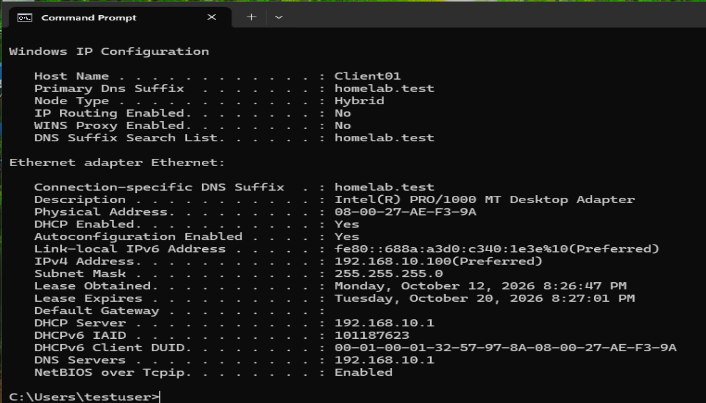
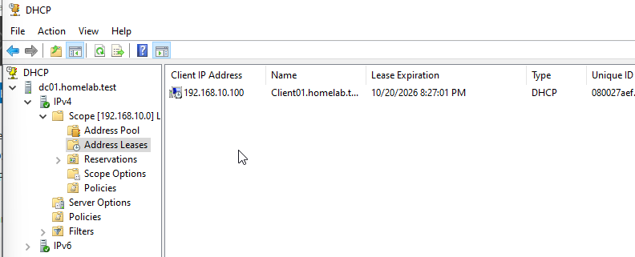
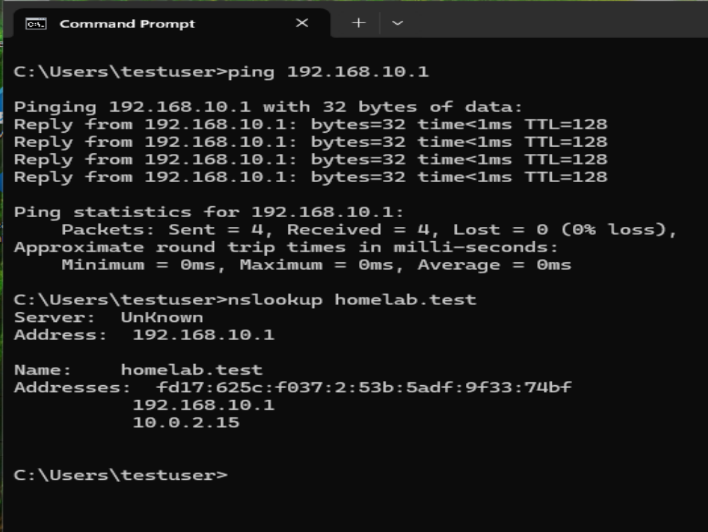
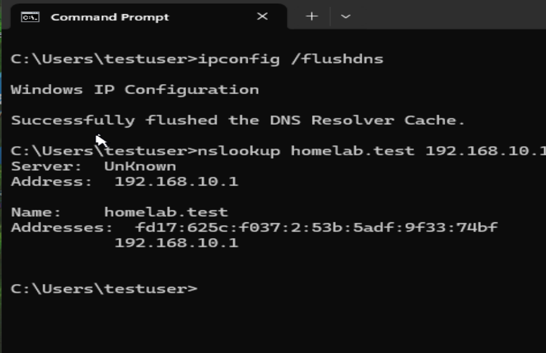

# windows-server-DHCP-homelab
Windows Server 2022 DHCP configuration, client IP assignment, and DNS troubleshooting homelab
# Windows Server 2022 — DHCP Homelab

## Project Overview

Configured and tested a DHCP server in a Windows Server 2022 Active Directory environment using Oracle VirtualBox.

The goal was to automatically assign IP addresses to Windows 11 clients, verify DHCP leases, and troubleshoot network connectivity and DNS issues.

## Lab Environment

| Component | Configuration |
|---|---|
| Virtualization | Oracle VirtualBox |
| Server | Windows Server 2022 (DC01) |
| Client | Windows 11 Pro (CLIENT01) |
| Domain | homelab.test |
| Internal Network | LabNet |
| Server IP | 192.168.10.1 |
| DHCP Scope | 192.168.10.100–192.168.10.200 |
| DNS Server | 192.168.10.1 |

## 1. DHCP Server Configuration

Installed and authorized the DHCP Server role on DC01.

Created and activated an IPv4 scope with the following settings:

- Address pool: 192.168.10.100–192.168.10.200
- Subnet mask: 255.255.255.0
- DNS server: 192.168.10.1
- DNS domain: homelab.test
- Lease duration: 8 days

The internal LabNet network does not use a default gateway.

## 2. DHCP Client Verification

Configured CLIENT01 to obtain its IPv4 address and DNS server settings automatically.

Used `ipconfig /all` to verify:

- DHCP Enabled: Yes
- Assigned IPv4 address: 192.168.10.100
- DHCP Server: 192.168.10.1
- DNS Server: 192.168.10.1

## 3. DHCP Lease Verification

Opened the DHCP management console on DC01 and confirmed that CLIENT01 received an active DHCP lease for 192.168.10.100.

## 4. Network Connectivity Testing

Tested communication between CLIENT01 and DC01 using:

`ping 192.168.10.1`

Results:

- 4 packets sent
- 4 packets received
- 0% packet loss

## 5. DNS Troubleshooting

During testing, `nslookup homelab.test` returned both the internal server address (192.168.10.1) and the VirtualBox NAT address (10.0.2.15).

Reviewed DNS records on DC01 and removed the unwanted NAT address record.

Flushed the DNS resolver cache and repeated the lookup against 192.168.10.1.

The final result returned the correct internal IPv4 address without the unwanted NAT address.

## Skills Demonstrated

- Windows Server 2022 administration
- DHCP installation and configuration
- DHCP scope and lease management
- Active Directory integration
- Windows 11 network configuration
- TCP/IP troubleshooting
- DNS record troubleshooting
- Command-line verification using ipconfig, ping, and nslookup

## Key Takeaways

This project helped me understand how DHCP automatically assigns network settings to clients and how to verify successful address allocation.

It also provided practical experience identifying and resolving DNS configuration issues in a Windows Server environment.
